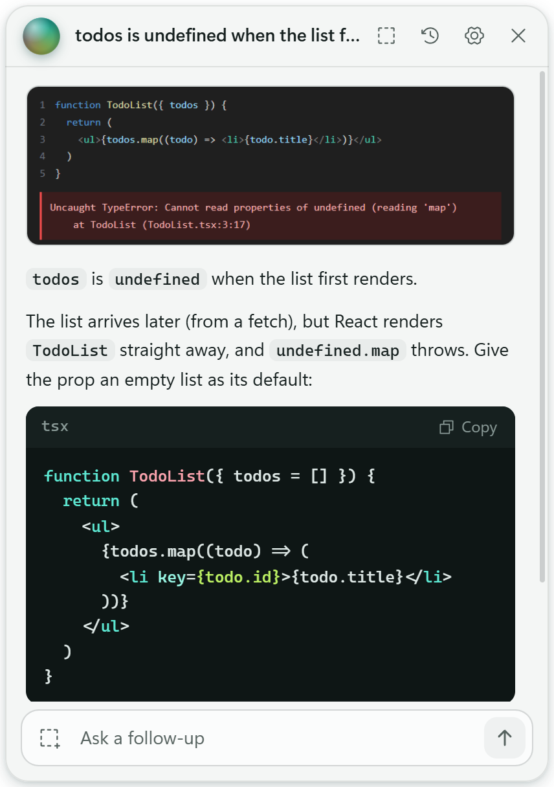
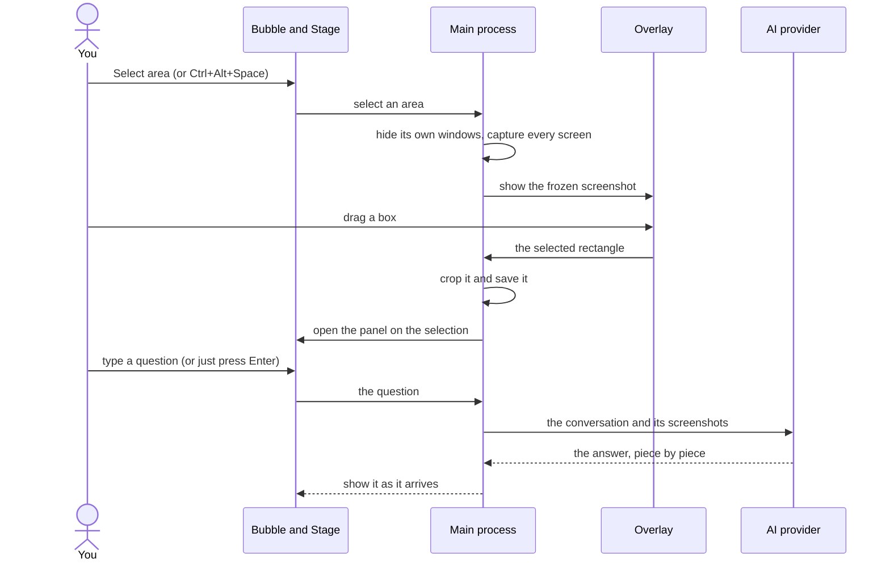

# ExScreenHelp

[](https://github.com/jerungpyro/ExScreenHelp/actions/workflows/ci.yml)
[](https://github.com/jerungpyro/ExScreenHelp/releases/latest)
[](LICENSE)

**Ask an AI about anything on your screen.** ExScreenHelp is a small floating orb for Windows 11. Click it (or press **Ctrl+Alt+Space**), drag a box around whatever you're looking at, and ask about it in a panel that grows out of the orb. Type a question, or just press Enter, and the AI of your choice answers.

<p align="center">
  <picture>
    <source media="(prefers-color-scheme: dark)" srcset="docs/images/panel-dark.png">
    
  </picture>
</p>

It works with **DeepSeek, OpenAI, Claude and Gemini**, using your own API key. Use it for code and error messages, homework questions, an article in another language, a chart, a form, or plain "what is this?".

## Features

- **Select any area of the screen.** The screen freezes while you drag, so menus and tooltips stay put. Then ask about it in your own words, or press Enter to have it explained.
- **A keyboard shortcut** that works from any app, so you don't have to reach for the orb.
- **Follow-up questions**, with more screenshots or pasted images (**Ctrl+V**) along the way.
- **Answers as they're written**, in Markdown with highlighted code and Copy buttons.
- **History** of every conversation, with its screenshots, to reopen and continue later.
- **A panel you can move and resize**, that reopens where you left it.
- **Preferences** that tell the AI how you like your answers (language, detail, how to explain code).
- **Light and dark mode**, following Windows.
- **Private by design:** your keys are encrypted, your history stays on your PC, and requests go straight to the provider you chose.

## Download

Get the latest version from the [Releases page](https://github.com/jerungpyro/ExScreenHelp/releases/latest). Pick one:

- **`ExScreenHelp-Setup-<version>.exe`**: installer. Installs for your user only (no admin rights needed) and adds Start menu and desktop shortcuts. Installing a newer version updates the old one. Remove it from Windows Settings → Apps.
- **`ExScreenHelp-<version>-win-x64.zip`**: portable. Unzip it anywhere and run `ExScreenHelp.exe`.

Requires Windows 11, 64-bit.

The app isn't code-signed, so Windows SmartScreen may say **"Windows protected your PC"** the first time. Click **More info**, then **Run anyway**.

## Setup

1. Click the orb and open **Settings**.
2. Choose your **Provider**. Its model and API address fill in automatically.
3. Get an API key from that provider (the **Get a key** link opens the right page) and paste it in. The provider bills API usage to your account.
4. Click **Test connection**. It saves your settings and checks that the key and model work.

| Provider | Default model | Get a key |
| --- | --- | --- |
| DeepSeek | `deepseek-flash` | [platform.deepseek.com](https://platform.deepseek.com/api_keys) |
| OpenAI | `gpt-6.1-sol` | [platform.openai.com](https://platform.openai.com/api-keys) |
| Claude | `claude-opus-5-5` | [platform.claude.com](https://platform.claude.com/settings/keys) |
| Gemini | `gemini-3.8-flash` | [aistudio.google.com](https://aistudio.google.com/apikey) |

You can change the model in Settings, as long as it accepts images (useful if a provider renames its default model). Each provider keeps its own key, so you can switch back and forth without pasting keys again.

## Using it

- **Ask about something on screen:** click the orb, choose **Select area** (or **New selection** at the top of the panel) and drag a box. Press **Esc** or right-click to cancel. The panel opens on your selection: type a question or instructions (for example "translate this into Malay"), or just press **Enter** to have it explained. With more than one screen, they all freeze, and you can select on any of them.
- **Keyboard shortcut:** press **Ctrl+Alt+Space** from any app to go straight to selecting an area. With a chat open, it adds a screenshot to your next follow-up instead. Choose a different shortcut, or turn it off, in Settings.
- **Follow up:** type in the box under the answer. **Enter** sends, **Shift+Enter** adds a new line. To show the AI something else, add a screenshot with the button beside the box, or paste an image (**Ctrl+V**), for example one taken with **Win+Shift+S**. Large pasted images are scaled down to 2000 pixels on their longest side.
- **Copy an answer:** click **Copy** under it. You get the Markdown, so headings, lists and code blocks keep their formatting when pasted into a document or chat. Each code block also has its own **Copy**.
- **Move or resize the panel:** drag the orb at its top left, or the empty part of its header, to move it. Drag any edge or corner to resize it. It reopens where you left it. If you later drag the orb (when the panel is closed) to a new spot, the panel opens beside it again, at the size you chose.
- **Pick up where you left off:** clicking the orb reopens the conversation you last had open. Click the orb at the top of the panel (or press **Esc**) to close it again.
- **History:** reopen any earlier conversation and keep asking, or delete it.
- **Preferences:** in Settings, tell the AI how you like your answers, for example which language to use, how much detail to give, or how to explain code. They're sent with every question, whichever provider you use.
- **Move the orb:** drag it anywhere, including onto another screen. It snaps to the nearest edge of that screen and fades when you're not using it. The menu and panel open on the screen the orb is on.
- **Tray icon:** show or hide the orb, or quit the app.
- **Launch at startup:** turn it on in Settings to start ExScreenHelp when you sign in to Windows.
- **Updates:** the bottom of Settings shows which version you have, and a **Download** button when a newer one is out.

## Privacy

- Only the area you select, or an image you paste, is saved or sent. The app briefly screenshots the whole screen to freeze it while you select, but keeps that image in memory only.
- The selected area, your questions and your Preferences are sent to the provider you chose (or to the API address set in Settings), and nowhere else. There is no analytics or telemetry.
- When you open Settings, the app asks GitHub for the latest version number (at most once an hour). Nothing about you or your chats goes with it.
- Your API keys are encrypted with Windows' built-in protection (DPAPI), so only your Windows account can read them.
- Conversations and their screenshots are stored on your PC in `%APPDATA%\ExScreenHelp\`. Uninstalling keeps them. To erase them, delete that folder.

## How it works

ExScreenHelp is an [Electron](https://www.electronjs.org/) app written in TypeScript, with React for the windows and [electron-vite](https://electron-vite.org/) to build it. It lives in the system tray and has no main window. What you see is three separate windows, all transparent and always on top.

| Window | What it does |
| --- | --- |
| **Bubble** | Holds the orb. It lets clicks pass through everywhere except the orb itself, snaps to the nearest screen edge, and stops animating when idle so it costs almost nothing while you work. |
| **Stage** | Draws the menu and the panel. It is never hidden: when closed it draws nothing and lets clicks through. That way it can paint an orb exactly on top of the bubble's before taking over, so the orb seems to grow into the panel without a flicker. While open it covers the screen, so you can move and resize the panel inside it smoothly, and it only takes clicks where something is drawn. |
| **Overlay** | Created for each selection, one on every screen. Each covers its screen with a still image of it, and you drag your box on that. |

### From a selection to an answer



1. ExScreenHelp hides its own windows, so they never appear in the screenshot, then captures every display at its full resolution.
2. The overlays show those captures as still images, and you drag a box on one of them.
3. Your box is measured in the display's scaled units, so it's converted to real pixels (this keeps the crop exact at 125% or 150% scaling). The crop is cut from that display's original, lossless capture and saved as a PNG in a new conversation folder. The full-screen captures are thrown away.
4. The panel opens on the selection and waits for your question. A selection you never ask about isn't kept: it's removed when you make another one, or the next time the app starts.
5. The request is built from a short built-in instruction, your Preferences and the whole conversation, including every screenshot, since AI providers keep no memory between requests.
6. The answer streams back and appears as it's written. When it's done, the conversation is saved and titled after the first line of the answer.

### Talking to the providers

- DeepSeek, OpenAI and Gemini are reached through their OpenAI-compatible APIs with the [`openai`](https://www.npmjs.com/package/openai) package. Claude uses Anthropic's own API through [`@anthropic-ai/sdk`](https://www.npmjs.com/package/@anthropic-ai/sdk). The provider list, with default models and addresses, is in [`src/shared/providers.ts`](src/shared/providers.ts).
- Requests go through Chromium's network stack rather than Node's, so they use Windows' proxy settings and trusted certificates. That's what makes the app work on company networks and with antivirus HTTPS scanning.
- An answer is given up on only when nothing arrives for two minutes, because reasoning models can think for a long time before the first word. If a DeepSeek, OpenAI or Gemini model refuses streaming, the app asks for the whole answer at once instead.
- Errors become plain messages that say what to do: a wrong key or model name points you to Settings, and an out-of-credit account, rate limits, network problems and timeouts each get their own message.

### Keeping things safe

- Only the main process holds API keys or touches the disk. The three windows run sandboxed, with no access to Node, and can only ask the main process for things through a small typed API (`window.api`) defined in the preload script. Every request they send is checked before it's acted on.
- API keys are encrypted with Electron's `safeStorage`, which uses Windows DPAPI.
- Saved screenshots reach the panel through a custom `capture://` address that only accepts the app's own conversation and file names, so it can't be used to read other files.
- The windows can't navigate away or open new windows. Links in answers open in your browser.
- Pasted images are decoded and re-encoded before they're saved, so only a clean PNG is stored.

### Where things are stored

`%APPDATA%\ExScreenHelp\`:

- `settings.json`: provider, model, API address, preferences, keyboard shortcut, bubble position, panel position and size, launch at startup
- `apikey.bin`: your DeepSeek API key, encrypted with DPAPI (the name is kept from version 1.0, when DeepSeek was the only provider)
- `apikey-openai.bin`, `apikey-claude.bin`, `apikey-gemini.bin`: the other providers' keys, encrypted the same way
- `history\<id>\`: one folder per conversation, holding `conversation.json` and its screenshots (`capture.png`, `capture-2.png`, …)

## Build from source

Needs Windows 11 and [Node.js](https://nodejs.org/) 22.12 or newer.

```powershell
npm install
npm run dev        # run with live reload
npm test           # unit tests (Vitest)
npm run typecheck  # type-check the main process and the windows
npm run format     # format the code with Prettier
npm run package    # portable build: dist\win-unpacked\ExScreenHelp.exe
npm run release    # public downloads: installer and zip in release\ (not code-signed)
```

`npm run make-icon` redraws `resources/icon.png`. For running a second copy next to your everyday one, troubleshooting, and the project's conventions, see [CONTRIBUTING.md](CONTRIBUTING.md).

### Project layout

```
src/
  main/        The main process, organised by feature
    capture/     screen capture, cropping, pasted images
    chat/        provider clients, request building, error messages, titles
    layout/      where the bubble, menu and panel go on screen
    storage/     settings, encrypted keys, history, the capture:// protocol
    updates/     asks GitHub whether a newer version is out
    windows/     the bubble, stage and overlay windows
    controller.ts  moves between idle, menu, panel and selecting
    ipc.ts         every request the windows can make, with its checks
    displays.ts    finds the screen the orb is on
    shortcut.ts    the global keyboard shortcut
  preload/     exposes window.api to the windows
  renderer/    one page per window: bubble, stage (menu and panel), overlay
  shared/      types, constants, the provider list, panel geometry and the window.api contract
```

Logic that doesn't need Electron (requests, errors, history, settings, layout) has unit tests next to it. The windows, the controller and IPC are checked by running the app.

The original design and plan, from before version 1.0, are in [`docs/design/`](docs/design/). The code has moved on since, so treat them as background.

## Contributing

Bug reports, ideas and pull requests are welcome.

- [CONTRIBUTING.md](CONTRIBUTING.md) covers setting up, the conventions, and how to send a change.
- Report bugs and suggest features in [issues](https://github.com/jerungpyro/ExScreenHelp/issues/new/choose).
- Report security problems privately, as described in [SECURITY.md](SECURITY.md).
- Everyone taking part is expected to follow the [code of conduct](CODE_OF_CONDUCT.md).

What changed in each version is in [CHANGELOG.md](CHANGELOG.md).

## License

[MIT](LICENSE)
